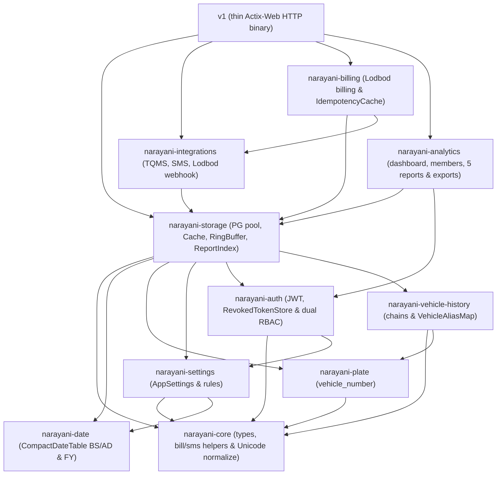

# Narayani Billing Backend (`v1`) — Complete Architecture, Route Matrix & Refactoring Specification

This document consolidates the **current implemented backend**, the **Reports Architecture (`reports-backend-architecture-guide.md`)**, and the **target modular Cargo workspace & Rust collections blueprint** so any engineer or agent can build, maintain, or refactor the **Narayani Billing Backend (`v1`)** cleanly from scratch.

---

## 1. Tech Stack & Project Layout

### 1.1 Workspace `Cargo.toml`
- **Workspace Members (11 crates, `resolver = "2"`):**
  - Root thin binary: `v1` (`version = "0.1.0"`, `edition = "2021"`)
  - Layer 0 leaf crates: `narayani-core`, `narayani-plate`, `narayani-date`
  - Layer 1 domain crates: `narayani-settings`, `narayani-auth`, `narayani-vehicle-history`
  - Layer 2 storage crate: `narayani-storage`
  - Layer 3 application/analytics crates: `narayani-integrations`, `narayani-billing`, `narayani-analytics`
- **Core Dependencies:**
  - Web & HTTP: `actix-web = { version = "4.3.1", features = ["rustls-0_21"] }`, `actix-cors = "0.6"`, `reqwest = { version = "0.12", features = ["json"] }`
  - Async & Streaming: `tokio = { version = "1.32", features = ["rt-multi-thread", "macros", "sync", "time", "net", "io-util", "fs"] }`, `futures-util = "0.3.34"`, `bytes = "1"`
  - Serialization & Exports: `serde = { version = "1.0", features = ["derive"] }`, `serde_json = { version = "1.0", features = ["preserve_order"] }`, `rust_xlsxwriter = "0.104.0"`, `csv = "1.4.0"`, `unicode-normalization = "0.1.26"`, `anyhow = "1.0.104"`
  - Database: `tokio-postgres = { version = "0.7.8", features = ["with-serde_json-1"] }`
  - Auth & TLS: `jsonwebtoken = "9.2"`, `rustls = "0.21"`, `rustls-pemfile = "1"`
  - Time & Env: `chrono = { version = "0.4", features = ["serde"] }`, `dotenv = "0.15"`

### 1.2 Directory & Module Structure
Workspace root contains `Cargo.toml`, `Cargo.lock`, `.env`, `billing-narayani.service`, `cert.pem`, `key.pem`, `private.pem`, `public.pem`, `date_range.json`, `logs/`, `crates/`, `src/`, and `target/`.

**Active `src/` HTTP modules wired in `src/main.rs`:**
- Core & Storage adapters: `main.rs`, re-exports (`resource`, `roles`, `date`, `vehicle_number`), `db.rs`, `cache.rs`
- Auth & Authorization: `auth.rs`, `middleware.rs`, `login.rs`, `access.rs`, `permissions.rs`
- Generic CRUD & Streaming: `actions.rs`, `api_stream.rs`
- Observability & Settings: `log.rs`, `audit.rs`, `settings.rs`
- Domain, Vehicles, Integrations & Reporting HTTP layers: `billing_actions.rs`, `tqms_integration.rs`, `sms.rs`, `dashboard_statistics.rs`, `members.rs`, `vehicle_history.rs`, `reports.rs`

---

## 2. Environment Variables & Deployment Configuration

| Variable | Default / Required | Used In | Purpose |
| :--- | :--- | :--- | :--- |
| `DATABASE_URL` | Required | `main.rs` | PostgreSQL connection URL |
| `APP_PORT` | `"5001"` | `main.rs` | HTTP listen port on `127.0.0.1:{APP_PORT}` |
| `TLS_CERT_PATH` | `"cert.pem"` | `main.rs` | TLS certificate path read by `load_tls_config()` |
| `TLS_KEY_PATH` | `"key.pem"` | `main.rs` | TLS private key path read by `load_tls_config()` |
| `JWT_USER_SECRET` | Optional env | `roles.rs` | Role secret helper (`Roles::jwt_secret()`) |
| `JWT_ADMIN_SECRET` | Optional env | `roles.rs` | Role secret helper (`Roles::jwt_secret()`) |
| `JWT_OPERATOR_SECRET` | Optional env | `roles.rs` | Role secret helper (`Roles::jwt_secret()`) |
| `LODBOD_SERVICE_TOKEN` | Optional | `billing_actions.rs` | Static Bearer token accepted for Lodbod endpoints alongside Admin/Operator JWT |
| `TQMS_BASE_URL` | Required for TQMS | `tqms_integration.rs` | Base URL for upstream TQMS API |
| `ACTION_LOG_FILE` | `"logs/actions.jsonl"` | `log.rs` | Optional local NDJSON mirror for action logs (outside `#[cfg(test)]`) |
| `SMS_API_BASE_URL` | SamayaSMS URL | `sms.rs` | Fallback SMS API URL (overridden by `SettingResource`) |
| `SMS_API_KEY` | Fallback constant | `sms.rs` | Fallback SamayaSMS API key |
| `SMS_SENDER_ID` | Optional | `sms.rs` | Fallback sender ID |
| `SMS_RESPONSE_TYPE` | Optional | `sms.rs` | Fallback SamayaSMS response type |
| `SMS_API_TYPE` | Optional | `sms.rs` | Fallback SamayaSMS API type |
| `SMS_API_SECRET` | Optional | `sms.rs` | Fallback SMS secret |
| `SMS_WEBHOOK_URL` | Optional | `sms.rs` | Fallback SMS webhook callback URL |
| `SMS_DEFAULT_COUNTRY_CODE` | Optional | `sms.rs` | Fallback default country code (e.g., `+977`) |
| `SMS_ROUTE_ID` | `"10244"` fallback | `sms.rs` | Route ID fallback when account requires explicit pricing route |
| `SMS_CAMPAIGN_ID` | `"8572"` fallback | `sms.rs` | Campaign ID fallback for SamayaSMS |

### Key & Certificate Files
- `private.pem` / `public.pem`: RSA keys in the working directory used by `auth.rs` for RS512 JWT signing and RS256/RS384/RS512 verification.
- `cert.pem` / `key.pem`: Loaded by `load_tls_config()` in `main.rs`. `HttpServer::bind(format!("127.0.0.1:{}", app_port))` binds plain HTTP on loopback (intended behind a reverse proxy) while `load_tls_config()` validates TLS files.
- `billing-narayani.service`: Systemd service running `/home/ubuntu/billing-narayani/v1/target/release/v1` with `APP_PORT=5001`, `Restart=on-failure`, `RestartSec=10s`.

---

## 3. Application Startup, `ServerData` & Migrations (`src/main.rs`)

### 3.1 Shared State
```rust
#[derive(Clone)]
pub struct ServerData {
    pub db: Arc<Database>,
    pub tqms_client: Arc<tqms_integration::TQMSClient>,
    pub cache: Arc<tokio::sync::RwLock<cache::Cache>>,
}
```
Wrapped in `Arc<ServerData>` and injected as `web::Data<Arc<ServerData>>`.

### 3.2 Boot & Shutdown Lifecycle
1. Load `.env` via `dotenv::dotenv().ok()`.
2. Connect to PostgreSQL via `db::connect_to_db(&database_url)` and construct `Database::new(Arc::new(client))`.
3. Call `db.create_tables().await` and `db.create_report_tables().await` to ensure all 14 resource tables and 3 indexed report projection tables (`report_receipts`, `report_receipt_items`, `report_vehicle_aliases`) exist (`CacheResource` is omitted).
4. Run startup data migrations (also runnable standalone via `--run-migrations`):
   - `create_admin_user_if_not_exists(&db)` — seeds initial Admin user if absent.
   - `add_sthaniya_branch_to_billing_rule_resources(&db)` — ensures `inner_content.sthaniyaBranch = "Loadboard sthaniya"` on `BillingRuleResource` rows missing it.
   - `migrate_fiscal_year_id_to_fiscal_year(&db)` — removes case-insensitive `fiscalYearId` / `fiscalyearid` from `BillResource` and `BillingRuleResource` and sets `fiscalYear` (e.g., `"2082/2083"`) if missing.
5. Hydrate cache & derived indexes (`ReportIndex`, `VehicleAliasMap`, cached `AppSettings`, `FiscalYearConfig`): `cache.load_from_db(&db).await`, followed by non-destructive `db.backfill_report_tables_if_empty(&cache.report_index).await` (inserts rows only when `report_receipts` is empty).
6. Hydrate v1.0 RBAC policies into `Cache.role_policies`: `permissions::hydrate_role_policies(&s_data).await`.
7. Start async MPSC workers and hydrate sequence counters:
   - `log::init_persistent_action_logger(&s_data).await`
   - `audit::init_persistent_audit_trail(&s_data).await`
8. Configure CORS (`Cors::permissive()` / exposed headers: `X-Stream-Format`, `X-Batch-Size`, `X-Concurrency`, `X-Total-Items`, `X-Total-Pages`, `X-Starting-Offset`) and bind Actix-web `HttpServer`.
9. On shutdown, drain MPSC queues cleanly:
   - `log::flush_action_logs().await;`
   - `audit::flush_audit_trail().await;`

---

## 4. Storage Model: PostgreSQL JSONB + In-Memory Cache (`src/resource.rs`, `src/db.rs`, `src/cache.rs`)

### 4.1 `ResourceName` & `DatabaseResource`
Every domain entity shares the same PostgreSQL envelope:
```rust
pub struct DatabaseResource {
    pub id: Option<i32>,
    pub resource_name: Option<ResourceName>,
    pub inner_content: Option<serde_json::Value>,
    pub external_content: Option<serde_json::Value>,
}
```
PostgreSQL table schema per DB-backed resource:
```sql
CREATE TABLE IF NOT EXISTS <lowercase_resource_name> (
    id SERIAL PRIMARY KEY,
    inner_content JSONB,
    external_content JSONB
);
```
`db.create_resource()` automatically stamps `external_content.createdTime` with an RFC 3339 timestamp (seconds precision).

**All 15 `ResourceName` Variants:**

| Variant | `Display` String | DB Table Created | Cached in `Cache` | Notes |
| :--- | :--- | :--- | :--- | :--- |
| `VehicleResource` | `"vehicleresource"` *(lowercase quirk)* | Yes | Yes (deduped) | Vehicle records (local + TQMS sync) |
| `UserResource` | `"UserResource"` | Yes | **No** (DB-only) | Never bulk-cached in `Cache.cache` |
| `BillResource` | `"BillResource"` | Yes | Yes | Receipts / bills |
| `MemberResource` | `"MemberResource"` | Yes | Yes | Members / drivers / owners |
| `ReportResource` | `"ReportResource"` | Yes | Yes | Saved/generated reports & RBAC target for `/api/v1/reports/*` |
| `SettingResource` | `"SettingResource"` | Yes | Yes | Tenant/system settings (`id = 1` typical) |
| `PermissionResource` | `"PermissionResource"` | Yes | **No** (`cache.cache`) | Legacy per-user docs & v1.0 role policies (v1.0 policies live in `cache.role_policies`) |
| `CacheResource` | `"CacheResource"` | **No** | No | Internal-only marker; excluded from `Database::new` |
| `VehicleCategoryResource` | `"VehicleCategoryResource"` | Yes | Yes | Vehicle categories (`category`, `vehicleTypes[]`) |
| `BillingRuleResource` | `"BillingRuleResource"` | Yes | Yes | Fee heads & billing rules (`resourceType`: `"FEE_HEAD"` \| `"BILLING_RULE"`) |
| `BillingEntityResource` | `"BillingEntityResource"` | Yes | Yes | Billing entities (VAT applicability) |
| `BranchResource` | `"BranchResource"` | Yes | Yes | Branch/office records |
| `ActionLogsResource` | `"ActionLogsResource"` | Yes | Yes | Persistent `ACTLOG-*` entries |
| `AuditTrailResource` | `"AuditTrailResource"` | Yes | Yes | Immutable `AUD-*` entries |
| `VehicleHistoryResource` | `"VehicleHistoryResource"` | Yes | Yes | Linked-list (`head -> next -> null`) per-vehicle identity & plate history |

### 4.2 `Cache` Mechanics (`src/cache.rs`)
- Current fields:
  - `cache: HashMap<ResourceName, HashMap<i32, DatabaseResource>>`
  - `fully_loaded: HashSet<ResourceName>`
  - `role_policies: HashMap<(String, String), RolePermissionResource>` (keyed by `(normalized_tenant_id, role_lowercase)`)
- **Uncached Resource Protection**: `actions::is_uncached_resource()` returns `true` for `UserResource` and `PermissionResource`. Reads hit DB directly (`read_uncached_resource_from_db`), and creating/updating them never evicts cached tables.
- **Querying & Read-Only Vehicle Number Expansion**: `search_innercontent` and `search_innercontent_batch` traverse dotted JSON paths (`matches_path`). When searching `VehicleResource` on a vehicle-number field (`is_vehicle_number_search_field`), `filter_matching` additionally consults `VehicleSearchExpansion::from_cache(self, search_query)` to match canonical Nepali plate aliases (`vehicle_number.rs`) and historical IDs/plates (`VehicleHistoryResource`) without modifying stored vehicle records.

### 4.3 `DatabaseResource` Envelope — Optional Components & Design Rationale
All four top-level fields on `DatabaseResource` are `Option<...>`:

| Field | Type | Optionality & Rationale |
| :--- | :--- | :--- |
| `id` | `Option<i32>` | Clients omit `id` on `POST /api/v1/create/{resource_name}` because PostgreSQL assigns `SERIAL PRIMARY KEY`. `db.read_resource()` returns `id: None` as a "not found" sentinel, and `members::synthesize_external_vehicle_resource()` creates external uncached records without a local DB ID. |
| `resource_name` | `Option<ResourceName>` | Clients may omit it in JSON request bodies because the URL path carries `{resource_name}`. Deserialization uses `ResourceName::from_str_case_insensitive()`, while `ToString` preserves `"vehicleresource"` for PostgreSQL table compatibility. |
| `inner_content` | `Option<serde_json::Value>` | Stores nullable PostgreSQL JSONB payloads, supporting heterogeneous schemas, partial updates, and "not found" (`None`) DB sentinels. |
| `external_content` | `Option<serde_json::Value>` | Isolates system-managed metadata (`createdTime`) from client-owned `inner_content`. |

### 4.4 Concrete Resource Structures & Optional Components

#### 1. `BillResource` & `DatabaseBillResource` (`src/billing_actions.rs`)
`DatabaseBillResource` mirrors `DatabaseResource` with `resource_name: Option<String>`. Inside `inner_content`, `BillResource` requires **`items: Vec<BillItem>`** (`title: String`, `amount: f64`) and **`total: f64`**:
- **Optional top-level fields**: `id`, `note`, `subtotal`, `discount`, `branch: Option<BranchInfo>`, `paidAt`, `vehicle: Option<BillVehicleInfo>`, `createdBy: Option<CreatedByInfo>`, `periodStart`, `periodEnd`, `billingDate`, `billingType`, `fiscalYearId` (plus migrated `fiscalYear`), `billingMonths`, `paymentMethod`, `receiptNumber`, `lodbodPaymentReferenceId`, `esewaTransactionId`, `sanghBranch` (alias `SanghBranch`), `status`.
- **Optional nested fields**:
  - `BillItem`: `ruleId`, `feeHeadId`, `billingEntity`, `billingEntityId`, `periodId` (`Option<String>`, `#[serde(default)]`).
  - `BranchInfo`: `id`, `name`, `phone`, `address`, `BranchCode`, `contactPerson`.
  - `BillVehicleInfo`: `id`, `phone`, `address`, `ownerName`, `vehicleType`, `vehicleNumber`, `sanghBranch` / `SanghBranch`.
  - `CreatedByInfo`: `id`, `name`, `username`.

#### 2. `PermissionResource` — Dual Schema (`src/permissions.rs` v1.0 & `src/access.rs` Legacy)
`is_role_permission_payload()` distinguishes v1.0 by `tenantId` present without `userId`:
- **v1.0 Tenant/Role Policy (`RolePermissionResource` / `RolePermissionPolicy`)**: Required `tenantId`, `role`; optional/defaulted `id`, `external_content`, `schemaVersion` (`"1.0"`), `status` (`"ACTIVE"`), `branchIds` (`Vec<i64>`, empty = all branches), `allow` / `deny` (`BTreeMap<String, Vec<String>>`), `requireAudit`, `createdBy` / `updatedBy`.
- **Legacy Per-User Policy (`PermissionResource` / `PermissionInnerContent`)**: Required `userId`, `userRole`; optional/defaulted `userPermissions`, `sthaniyaBranch`, `Allowed: Vec<AllowedRule>` (`AllowedScope` accepts `"all"`/`"*"` or mixed string/int `Vec<ScopeId>`).

#### 3. `SettingResource` (`AppSettings` in `src/settings.rs`)
- All sections use `#[serde(default)]` with defaults (`vat.rate = 13.0`, `cancellation.hours = 24`, `minPaidRules = 1`, `yearsBack = 4`, `yearsForward = 1`, `provider = "samayasms"`, `displacedTagging.enabled = true`).
- Sections: `billing` (`vat`, `arrears`, `linkedFeeRules`), `receipts` (`cancellation`), `insurance` (`eligibility`), `fiscalYear` (`selector`, `billingAccess`, `activeFiscalYears`), `integrations` (`tqms`), `notifications` (`sms`), `vehicleManagement` (`displacedTagging`), plus target `reports.mahasang` (`defaultGroupId`, `defaultVehicleTypes`, `vehicleTypeGroups[]`).
- Custom string/int deserializers (`deserialize_opt_string_id`, `deserialize_string_id`, `deserialize_string_id_vec`) accept both JSON numbers and strings.

#### 4. `VehicleHistoryResource` (`VehicleHistoryChain` & `VehicleHistoryNode` in `src/vehicle_history.rs`)
- **`VehicleHistoryChain`**: `schemaVersion` (`1`), `vehicleUid` (`VHIST-<seq>`), `currentDbId`, `currentVehicleId`, `currentVehicleNumber`, `knownDbIds: Vec<i32>`, `knownVehicleIds: Vec<String>`, `knownVehicleNumbers: Vec<String>`, `knownCanonicalVehicleNumbers: Vec<String>`, `nodeCount`, `head: Option<Box<VehicleHistoryNode>>`.
- **`VehicleHistoryNode`**: `nodeId` (`VNODE-<seq>`), `sequence`, `changeType` (`VehicleChangeType::{Create, Update, Delete, IdentityChange, VehicleNumberChange, Sync}`), `timestamp`, `dbId`, `vehicleId`, `vehicleNumber`, `normalizedVehicleNumber`, `canonicalVehicleNumber`, `numberChangeKind: Option<VehicleNumberChangeKind>` (`CanonicalFormatAlias | ZoneToProvinceTransition | PlateNumberChanged`), `changedFields: Vec<VehicleFieldDiff>`, `snapshot: Option<Value>`, `changedBy`, `reason`, `next: Option<Box<VehicleHistoryNode>>`.

#### 5. `ActionLogsResource` & `AuditTrailResource`
- **`ActionLogEntry`** (`src/log.rs`): Required `id` (`ACTLOG-<seq>`), `action`, `performed_at`, `status_code`, `success`, `duration_ms`; optional `resource_name`, `resource_id`, `performed_by`, `user_id`, `role`, `details`, `metadata`.
- **`AuditTrailEntry`** (`src/audit.rs`): Required `schema_version` (`1`), `audit_id` (`AUD-<seq>`), `timestamp`, `category`, `action`, `outcome`, `status_code`, `actor`, `request`, `summary`; optional `resource_name`, `resource_id`, `before_state`, `after_state`, `changes`, `metadata`.

#### 6. Schema-by-Convention JSONB Resources
`UserResource`, `VehicleResource`, `MemberResource`, `BillingRuleResource`, `BillingEntityResource`, `BranchResource`, `VehicleCategoryResource`, `ReportResource`, and internal `CacheResource` (no DB table).

---

## 5. Authentication & Authorization (`src/roles.rs`, `src/auth.rs`, `src/middleware.rs`, `src/login.rs`, `src/access.rs`, `src/permissions.rs`)

### 5.1 JWT & Middleware
- `Roles`: `User`, `Admin`, `Operator`.
- `Claims`: `sub` (email), `exp`, `iat` (24h TTL), `role`, `user_id: Option<i32>`, `jti: Option<String>`, `role_name: Option<String>`, `tenant_id: Option<String>`.
- `AuthMiddleware::new()` / `with_role(role)` / `with_roles(&[...])`: verifies `Authorization: Bearer <token>`, checks `!access::is_token_revoked(token)`, verifies RS512/RS384/RS256 against `public.pem`, checks `required_roles`, inserts `Claims` into `req.extensions()`.

### 5.2 Dual-Mode RBAC (`src/permissions.rs` & `src/access.rs`)
- **v1.0 Role-Based Tenant Policy (`is_allowed`)**:
  1. `SuperAdmin` (`isSuperAdmin` / `role_name == "SuperAdmin"`) bypasses across tenants in code (no DB document).
  2. Require `status == "ACTIVE"` and `tenant_id == tenant`.
  3. If `branch` is `Some(b)` and `branchIds` non-empty, require `branchIds.contains(&b)`.
  4. `deny` (checking `[resource, "*"]` and `[action, "*"]`) always beats `allow`; default deny.
  5. Hardcoded `ACTION_CATALOG` defines 4 base actions (`CREATE`, `READ`, `UPDATE`, `DELETE`) plus domain actions (`BillResource`: `CANCEL`, `CORRECT`, `PRINT`, `REPRINT`, `REPAIR_INVOICE`, `VOID`; `ReportResource`: `EXPORT`; `PermissionResource`: `ASSIGN`, `REPAIR_ACCESS_CONTROL`; etc.). `ActionLogsResource` & `AuditTrailResource` only ever permit `READ`; `CacheResource` is never granted.
- **`FallbackLegacy`**: Used when no v1.0 `RolePermissionPolicy` is stored for `(tenant_id, role)`, falling back to `AuthMiddleware` + `access.rs` per-user permissions & creator branch inheritance.

---

## 6. Nepali Plate Parser, History Tracking & Read-Only Search Broadening (`src/vehicle_number.rs`, `src/vehicle_history.rs`)

### 6.1 Structured Plate Parser (`src/vehicle_number.rs`)
- Parses both **7-Province** (`Province-4-15-23-KHA-5555`, `Ga Pra 15-23-KHA-5555`, `P4-15-23-KHA-5555`, `Gandaki Pradesh ...`, etc.) and **14-Zone** (`BA-23-KHA-5555`, `Bagmati 23 KHA 5555`, etc.) Nepali registration plates into `VehicleNumber { vehicle_state: VehicleState, transport_office: Option<TransportOffice>, group_code: GroupCode, vehicle_category: VehicleCategory, registration_number: u32 }`.
- Canonical `Display` formats provinces as `Province-<1..7>-<office>-<group>-<CAT>-<reg>` and zones as `<ZONE_CODE>-<group>-<CAT>-<reg>`.
- Pure read-only helpers: `parse_vehicle_number`, `canonical_vehicle_number`, `canonical_normalized_key`, `are_equivalent_vehicle_numbers`, `is_zone_to_province_transition_parsed`, `is_zone_to_province_transition`.

### 6.2 Vehicle-Number-Only History & Non-Mutating Search Broadening
- **`detect_vehicle_number_only_change(before, after)`**: Returns `Some(VehicleNumberOnlyChange)` when `compute_field_diffs` differs **only** on vehicle number fields (`VehicleNumber` / `vehicleNumber` / `NormalizedVehicleNumber` / `normalizedVehicleNumber`), classifying `CanonicalFormatAlias` vs `ZoneToProvinceTransition` vs `PlateNumberChanged`.
- **Automatic hooks**: Triggered on `VehicleResource` create/update/delete (`actions.rs`), TQMS sync creation or number-only match (`tqms_integration.rs`), and manual `POST /api/v1/vehicles/history/record`.
- **Read-only search guarantee**: Neither `Cache::filter_matching` (`cache.rs`) nor `search_cache_vehicles_with_id_lookup` (`tqms_integration.rs`) mutates stored `VehicleResource` records; `VehicleSearchExpansion::from_cache` broadens queries using canonical plate equivalence and linked `VehicleHistoryResource` chains while honoring non-number filters (`owner_name`, `sangh_branch`, `status`).

---

## 7. Complete Route Inventory (Existing Endpoints)

| Group | Method & Path | Handler | Auth / Notes |
| :--- | :--- | :--- | :--- |
| Root | `GET /` | `main::server_routes` | Lists registered routes |
| Auth | `POST /api/v1/auth/login` | `login::login` | Strips `password`; attaches policy/permissions + RS512 JWT |
| Auth | `POST /api/v1/auth/logout` | `access::logout` | Revokes token + cleans legacy session |
| Access | `GET /api/v1/access/me`, `GET/PUT /api/v1/access/user/{user_id}`, `POST /api/v1/access/permission` | `access` | Auth (`User\|Admin\|Operator`) + `PermissionResource:ASSIGN` on writes |
| Permissions v1.0 | `GET /catalog`, `GET /me`, `POST /check`, `POST /seed-defaults`, `POST /repair`, `GET/POST ""`, `PUT /{id}`, `GET /{tenant_id}/{role}` under `/api/v1/permissions` | `permissions` | Auth + `PermissionResource:READ`/`ASSIGN` |
| Generic CRUD | `POST /api/v1/create/{r}`, `GET /api/v1/read/{r}/{id}`, `PUT /api/v1/update/{r}/{id}`, `DELETE /api/v1/delete/{r}/{id}`, `GET /api/v1/search/{r}/{search_query}/{search_item}/{limit}` | `actions` | Auth + `enforce_request_permission`. *(Note: URL path param order `search_query`/`search_item` maps to `search_item`/`search_query` tuple positions in `actions.rs` & `api_stream.rs`.)* |
| NDJSON Stream | `GET /api/v1/streams/search/{r}/{search_query}/{search_item}/{limit}/{offset}` | `api_stream::search` | Auth + `READ`; compresses (`Compress`); batch size `5000` for `"all"` |
| Vehicle History | `GET /api/v1/vehicles/history`, `POST /record`, `GET /{identifier}` | `vehicle_history` | Auth + `VehicleHistoryResource:READ`/`UPDATE` |
| Bills | `POST /create`, `PUT /modify/{id}`, `DELETE /delete/{id}`, `POST /rollback/{id}`, `GET /logs`, `GET /logs/{bill_id}` under `/api/v1/bills` | `billing_actions` | Role + domain RBAC + `SettingResource` VAT/FY/cancelled/linked-fee checks |
| Lodbod | `POST /vehicles/billing-details`, `POST /payments/vehicle-receipts`, `GET /payments/{lodbodPaymentReferenceId}/vehicle-receipts` under `/api/integrations/lodbod/v1` | `billing_actions` | `LODBOD_SERVICE_TOKEN` or Admin/Operator JWT; `VEHICLE_MISMATCH` (`400`) on `vehicleId` vs `vehicleNumber` conflict; validates `sthaniyaBranch` against `VehicleResource.SanghBranch`; falls back to `"Loadboard sthaniya"` fee heads with placeholder message when sangh lacks rules; omits `periods` & `paymentHistory` in `/billing-details`; `periods` optional on `/vehicle-receipts` |
| TQMS | `POST /api/v1/tqms/search`, `GET /validate/{vehicle_number}`, `GET /vehicle_details/{vehicle_number}`, `GET /sync`, `GET /sync/{concurency}`, `GET /stream_sync/{batch_size}/{concurrency}`, `GET /api/v1/read_all/VehicleTypes`, `GET /api/v1/get_vehicles_tqms` | `tqms_integration` | Streams SSE (default) or NDJSON; records `VehicleHistoryResource` on sync *(preserve `/sync/{concurency}` spelling for backward compatibility)* |
| SMS | `GET /templates`, `GET /templates/{id}`, `POST /preview`, `POST /send`, `POST /send-raw` under `/api/v1/sms` | `sms` | SamayaSMS provider + settings templates + 500ms rate limit |
| Settings | `GET /resolved`, `POST /billing/calculate-vat`, `GET /billing/arrears/{vehicle}`, `POST /billing/linked-fees/evaluate`, `GET /receipts/cancellation-check/{bill_id}`, `GET /insurance/eligibility/{vehicle}`, `GET /fiscal-year/selector`, `GET /fiscal-year/access/{fiscal_year:.*}`, `GET /vehicle-management/displaced-tagging` under `/api/v1/settings` | `settings` | Auth + redacts SMS secrets for non-Admin callers |
| Dashboard & Members | `GET /api/v1/dashboard/statistics`, `GET /api/v1/dashboard/statistics/{fiscal_year:.*}`, `GET /api/v1/dashboard/members/...`, `GET /api/v1/members/...` | `dashboard_statistics`, `members` | Supports slash-separated FYs (e.g. `/2082/2083`); explicit BS `fiscalYear` is authoritative over `periodStart`; counts only vehicles with $\ge 1$ non-`CANCELLED`/non-ignored `BillResource`; scopes `total_users`, `total_inactive_users`, and `displaced_users` to `<= target_fiscal_year` |
| Logs & Audit | `GET /api/v1/logs/actions`, `GET /api/v1/logs/actions/{resource_name}`, `GET /api/v1/audit`, `GET /api/v1/audit/summary`, `GET /api/v1/audit/entity/{resource_name}/{resource_id}` | `log`, `audit` | Admin-only; buffered async PostgreSQL persistence via unbounded MPSC channels |

---

## 8. Backend Reports Specification (`/api/v1/reports/*` — Target Spec)

Authoritative specification from `reports-backend-architecture-guide.md` moving all 5 reports from client-side `GET /api/v1/read/BillResource/all` joins to RBAC-enforced, paginated, indexed backend endpoints (`<150ms` target at 500k+ receipts):

### 8.1 Shared Cross-Report Contract
- **Authentication & RBAC:** Require `AuthMiddleware::with_roles(&[User, Admin, Operator])` + `enforce_request_permission(..., "ReportResource", action::READ | action::EXPORT, branch_id)`.
- **Server-Side Branch Lock:** Non-Admin users assigned a branch in `UserResource` have `branch` overridden server-side to their assigned branch (never trust client `branch=all`).
- **Common Filters:**
  - `fiscalYear`: Canonicalize Nepali digits/dashes (`२०८३-८४`, `2083/2084` $\rightarrow$ `2083/84`); `'all'` disables FY filtering.
  - `branch`: Case-insensitive `TRIM(LOWER(...))` against `branch.name`.
  - `user`: Case-insensitive match against `userName`, `createdBy.name`, `createdBy.username` using `UserResource` name$\leftrightarrow$email aliases.
  - `feeHead`: Matches if any `items[]` entry has `feeHeadId == feeHead` or `normalize(title) == normalize(feeHead)`.
  - `dateFrom`, `dateTo` (`YYYY-MM-DD` AD) & `dateBasis` (`'paymentDate' | 'billingDate'`, default `'paymentDate'`).
    - `paymentDate`: `DATE(paidAt)` || `paymentDate` || `billingDate`.
    - `billingDate` (Income / Fee-Head Wise / Vehicle Category): `billingDate`.
    - `billingDate` (Mahasangh): **validity interval overlap** (`periodEnd >= dateFrom && periodStart <= dateTo`, with `periodStart = periodStart || billingDate`, `periodEnd = periodEnd || validUntil || periodStart`).
  - **Invalid Date Range:** Malformed `dateFrom`/`dateTo` or `dateFrom > dateTo` MUST return `200 OK` with empty `rows: []`, `total: 0`, and zeroed totals (never `500` or unfiltered rows).
- **Monetary & Identity Rules:**
  - `status: null` / omitted (when not cancelled/void/deleted/amended/rolled_back) defaults to `"PAID"`; Lodbod/online `billingType: null` defaults to `"MEMBERSHIP"`; missing `receiptNumber` falls back to `"{BranchCode}.{id}"` (or `id`).
  - Only `status == "PAID"` contributes to monetary sums (`totalIncome`, `membershipIncome`, `otherIncome`, category/grand totals).
  - Non-`PAID` receipts may appear as rows in Mahasangh / Member Transaction tables with `0` monetary value.
  - `normalizeKey`: Devanagari `[०-९]` $\rightarrow$ ASCII `[0-9]`, Unicode NFKC, strip zero-width chars, lowercase, collapse whitespace; strip `[^\p{L}\p{N}]` for vehicle plate matching.
  - Exports support streaming `.xlsx` (`rust_xlsxwriter`) and formula-injection-safe `.csv` (`csv`, prefixing `=`, `+`, `-`, `@`, `\t`, `\r` with `'`); `format=pdf` returns HTTP `501 Not Implemented` JSON.

### 8.2 All 13 Report Endpoints

| Route | Purpose & Output Contract |
| :--- | :--- |
| `GET /api/v1/reports/filter-options` | Returns `fiscalYears`, RBAC-filtered `branches`, `fiscalYear`-scoped `feeHeads`, `branch`-scoped deduplicated `users`, plus (`reportType=mahasang\|vehicle-category`) `categories`, `vehicleTypes`, `vehicleTypeGroups`, `defaultVehicleTypes` (`SettingResource.reports.mahasang`). |
| `GET /api/v1/reports/income` | Paginated unique receipts (`pageSize` default `15`, max `200`, `sortBy` allowlist) + `summary.{totalIncome, totalTransactions}` (`PAID`-only distinct receipts). |
| `GET /api/v1/reports/income/export` | `format=xlsx\|csv\|pdf`; 14-column landscape Amdani layout splitting `membershipAmount` (`billingType != 'GENERAL'`) vs `otherAmount`, multi-owner formatting (`संचालक:` / `धनीको नाम:`), and summary footer. |
| `GET /api/v1/reports/fee-head-wise` | Ordered `configuredFeeHeads` (`displayOrder`), pruned `visibleFeeHeads` (non-zero `allTotals` matching `feeHead` filter), receipts sorted `billingDate DESC, receiptNumber DESC`, `pageTotals`, and `allTotals`. |
| `GET /api/v1/reports/fee-head-wise/export` | `format=xlsx\|pdf` matrix export matching `visibleFeeHeads` and totals. |
| `GET /api/v1/reports/vehicle-category` | Resolves category (`VehicleCategoryResource.vehicleTypes[]`; blank $\rightarrow$ `'वर्ग उपलब्ध छैन'`, unmapped $\rightarrow$ `'वर्गीकृत नभएको'`), extracts `Compliance.RoutePermit.{route, routePermitExpiry}`, `pageSize` default `50` (`25\|50\|100`), `pageTotals` & `filteredTotals`. |
| `GET /api/v1/reports/vehicle-category/export` | `format=xlsx\|pdf` category breakdown export. |
| `POST /api/v1/reports/mahasang` *(also `GET` query alias)* | Body filters (`vehicleTypes: string[]` avoiding URL limits; defaults from `SettingResource.reports.mahasang` when omitted, `[]` = all), Mahasangh interval overlap on `dateBasis=billingDate`, priority vehicle history alias resolution (`previousVehicleIds` $\rightarrow$ `previousVehicleNumbers` $\rightarrow$ `VehicleId` $\rightarrow$ `VehicleNumber`), `summary.{totalBills, totalMembership, totalOther}`, paginated rows. |
| `POST /api/v1/reports/mahasang/export` | `format=xlsx\|pdf` with `filters` + `visibleColumns`. |
| `GET /api/v1/reports/member-transactions/search?q=...` | Normalized candidate search across `MEMBERSHIP` receipts, `MemberResource`, and `VehicleResource` enforcing caller branch RBAC; blank `q` returns `[]`. |
| `GET /api/v1/reports/member-transactions/{vehicleKey}` | Member profile (`MemberResource` + `VehicleResource` + `VehicleCategoryResource` + `lastPrintedAt` + TQMS `Compliance` preferring BS dates) + paginated membership transactions sorted by `paymentDate` + per-row `extraAmount` + `totalPaid`/`totalExtra`. |
| `GET /api/v1/reports/member-transactions/{vehicleKey}/export` | `format=xlsx\|pdf` member transaction statement export. |

Extra-amount formula per receipt row in Member Transaction Report:
$$\text{extraAmount} = \max\left(0,\; \text{receipt.totalAmount} - \sum \text{receipt.items[].amount}\right)$$

### 8.3 PostgreSQL Read-Model Tables & Composite Indexes
Mutations on `BillResource`, `VehicleResource`, and `VehicleHistoryResource` project synchronously into three indexed relational tables via `reports::sync_report_projection`:
1. **`report_receipts`** — `receipt_id (PK)`, `receipt_number`, `billing_type`, `status`, `branch_id`, `branch_name_lower`, `fiscal_year_id`, `fiscal_year_canonical`, `created_by_id`, `created_by_name`, `created_by_username`, `vehicle_id`, `vehicle_number_norm`, `vehicle_type_norm`, `customer_name`, `customer_phone`, `payment_date`, `billing_date`, `period_start`, `period_end`, `billing_months`, `subtotal`, `discount`, `vat_amount`, `total_amount`, `payment_method`, `paid_at`, `created_at`
   - Indexes: `idx_rr_fy_branch_status_pay`, `idx_rr_fy_branch_status_bill`, `idx_rr_vehicle_id_type_pay`, `idx_rr_vehicle_num_type`, `idx_rr_validity`.
2. **`report_receipt_items`** — `(receipt_id, item_index)` PK (FK `ON DELETE CASCADE`), `fee_head_id`, `fee_title_norm`, `billing_entity_id`, `amount`
   - Indexes: `idx_rri_fee_head`, `idx_rri_receipt`.
3. **`report_vehicle_aliases`** — `alias_key (PK)`, `alias_kind`, `alias_vehicle_id`, `alias_vehicle_number_norm`, `current_vehicle_id`, `current_vehicle_number`, `previous_vehicle_number`
   - Index: `idx_rva_curr_vid`.

---

## 9. Modular Cargo Workspace & Rust Collections (Implemented)

### 9.1 11-Crate Workspace Dependency DAG
Splitting `v1` into an acyclic 5-layer workspace isolates pure domain logic from `actix-web`, `reqwest`, and `tokio-postgres`, trims `tokio` features (`["rt-multi-thread", "macros", "sync", "time", "net", "io-util", "fs"]`), drops `futures` in favor of `futures-util`, and enables `[profile.dev]` `debug = "line-tables-only"` with `[profile.dev.package."*"] opt-level = 2`:



### 9.2 Implemented Rust Collections per Data Structure

| Component | Rust Collection | Purpose |
| :--- | :--- | :--- |
| **Vehicle History / Alias Map** | `VehicleAliasMap` (`by_prev_vehicle_id`, `by_prev_plate_norm`, `by_curr_vehicle_id`, `by_curr_plate_norm`, `by_curr_canonical_norm` with `Arc<VehicleAliasTarget>`) | O(1) priority resolution (`previousVehicleIds` -> `previousVehicleNumbers` -> `VehicleId` -> `VehicleNumber`) |
| **Unified AD↔BS Date Table** | `OnceLock<CompactDateTable>` using `HashMap<u32, u32>` (packed `yyyymmdd`) | Single compact instance shared across date, settings, analytics, and report projection |
| **In-Memory `ReportIndex`** | `BTreeMap<i32, Arc<ProjectedReceipt>>` + secondary `BTreeMap<NaiveDate, Vec<i32>>` (`payment_date`, `billing_date`, `period_end`), `HashMap<Box<str>, Vec<i32>>` (`fiscal_year`, `branch_lower`, `fee_head_id`, `vehicle_norm`) | Fast filtering, date-range pruning, and interval overlap without re-parsing JSONB |
| **RBAC Role Policies** | `HashMap<(String, String), RolePermissionResource>` on `Cache.role_policies` | O(1) tenant + role lookup isolated from legacy `PermissionResource` session cache |
| **Token Revocation & Idempotency** | `RevokedTokenStore` (`RwLock<HashMap<Box<str>, i64>>` pruning expired `exp` on revoke) and `IdempotencyCache` (`BoundedIdempotencyMap` with `BTreeMap<i64, Vec<String>>` TTL expiry + 10k cap) | Prevents unbounded memory growth from revoked JWTs and Lodbod retry keys |
| **Audit / Action Hot Buffers** | `RingBuffer<T>` (`VecDeque`, cap `10_000`) & bounded in-memory audit mirror (`10_000`) paired with async `mpsc` PG persistence | O(1) bounded in-memory ring eviction while keeping full history in PostgreSQL |
| **Resolved Tenant Settings** | Cached `Option<Arc<AppSettings>>` on `Cache` invalidated on `SettingResource` writes/deletes | Avoids repeated JSON deserialization across report and filter-option calls |

---

## 10. Build, Verification & Testing Guide

### 10.1 Compile & Run
```bash
# Typecheck application and unit/integration tests
cargo check --bin v1 --tests

# Run startup migrations only
cargo run --bin v1 -- --run-migrations

# Run server (requires PostgreSQL DATABASE_URL + PEM files)
cargo run --bin v1
```

### 10.2 Running Tests Safely
Most unit and integration tests use `access::test_helpers::create_mock_server_data_with_state` (`MockDbState`, an in-memory PostgreSQL wire-protocol mock), so no live PostgreSQL instance is needed for automated verification.

> **Important Pitfall:** `sms::tests::test_live_send_paid_sms_using_setting_resource_template` performs a **live outbound SMS HTTP request** via SamayaSMS. Always exclude `test_live_` tests during automated verification:
```bash
cargo check --workspace --tests
cargo test --workspace -- --skip test_live_
```
